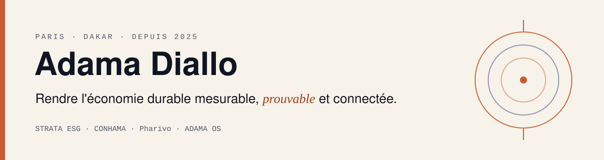

  

### Bonjour, je suis Adama.

Je travaille sur une question : **comment une économie peut-elle prouver ce qu'elle affirme, et trouver ceux avec qui elle peut agir ?**

Sur le terrain RSE, j'ai vu le même scénario se répéter : des mois de collecte, un rapport de quatre-vingts pages, et le jour du contrôle plus personne ne sait d'où sort le chiffre de la page 42. Le marché n'a pas un problème de données. Il a un problème de preuve.

J'y réponds par deux chantiers : rendre chaque chiffre de durabilité défendable le jour du contrôle, et rendre lisible l'écosystème de la durabilité pour que ses acteurs se trouvent au lieu de se chercher. Je conçois, je code et je vends l'essentiel de ce que je mets en production.

## Ce que je construis

| Projet | Ce que c'est | Où le voir |
| :-- | :-- | :-- |
| **STRATA ESG** | Co-fondateur. Logiciels de pilotage ESG pour les PME, les ETI et les consultants RSE, avec une règle : aucune affirmation sans preuve. | [strata-esg.fr](https://strata-esg.fr) |
| ↳ ESG Optimizer | Le cockpit. La donnée entre une fois, avec sa pièce justificative, puis se projette vers VSME, ESRS, GRI, CDP ou la taxonomie sans jamais être ressaisie. | [esg-optimizer.fr](https://esg-optimizer.fr) |
| ↳ STRATA Scope | Le bilan d'émissions de gaz à effet de serre selon le GHG Protocol, scopes 1, 2 et 3. Chaque tonne reste rattachée à son facteur, sa source et son incertitude. | |
| ↳ STRATA Watch | Une veille réglementaire qu'on peut opposer, pas seulement lire. | |
| ↳ STRATA Foundation | Gratuit, pour comprendre ce qui s'applique avant d'outiller quoi que ce soit. | |
| **CONHAMA** | La carte des acteurs de l'économie durable. Le référencement est gratuit et la carte ne favorise personne. | [conhama.com](https://conhama.com/fr) |
| **Pharivo** | Des logiciels de santé pour l'Afrique de l'Ouest, nés à Dakar, en commençant par l'officine. | [pharivo.com](https://pharivo.com) |
| **ADAMA OS** | Mon laboratoire public : un carnet daté de ce qui a été fait, pourquoi, avec quelle preuve et quelles limites. | [adamesg-os.fr](https://adamesg-os.fr) · [code](https://github.com/adama-diallo-rse/adama-os) |

## Comment je travaille

- **La preuve d'abord.** Une entreprise ne pilote bien que ce qu'elle sait prouver. Chaque chiffre garde sa source, sa date et sa pièce.
- **Du texte réglementaire au produit.** CSRD et ESRS, VSME, GHG Protocol, taxonomie européenne, CSDDD, allégations environnementales : je pars de ce que le texte exige et je le traduis en écran.
- **Du design au closing.** Conception, structuration, code et go-to-market, sur la même table.
- **En public.** Je documente ce qui marche, ce qui a été réfuté et ce qui reste incertain.

## Outils

  
  
  
  
  
  
  
  
  
  
  
  
  

## Parcours

J'ai grandi à Ziguinchor, en Casamance, et je suis arrivé en France en 2020. BTS informatique, licence d'administration et échanges internationaux, puis master Sustainability and Green Business à l'UPEC. J'ai travaillé sur l'industrialisation du reporting CSRD à la direction RSE d'AG2R La Mondiale.

Je parle français, anglais et espagnol, et je comprends le wolof et le pular.

## Ce vers quoi je vais

- Faire de la preuve le standard du reporting de durabilité des PME et des ETI.
- Relier les acteurs de l'économie durable, d'abord en Île-de-France, puis au-delà.
- Bâtir depuis Dakar des logiciels pensés pour l'Afrique de l'Ouest.
- Construire des actifs qui durent.

## Me joindre

- Un premier échange de 30 minutes : [cal.com/adama-diallo-rse/reserver](https://cal.com/adama-diallo-rse/reserver)
- Me lire toutes les deux semaines, la lettre SIGNAL : [adamesg-os.fr/lettre](https://adamesg-os.fr/lettre)
- [LinkedIn](https://www.linkedin.com/in/adama-diallo-rse) · [strata-esg.fr](https://strata-esg.fr) · [adamesg-os.fr](https://adamesg-os.fr)
